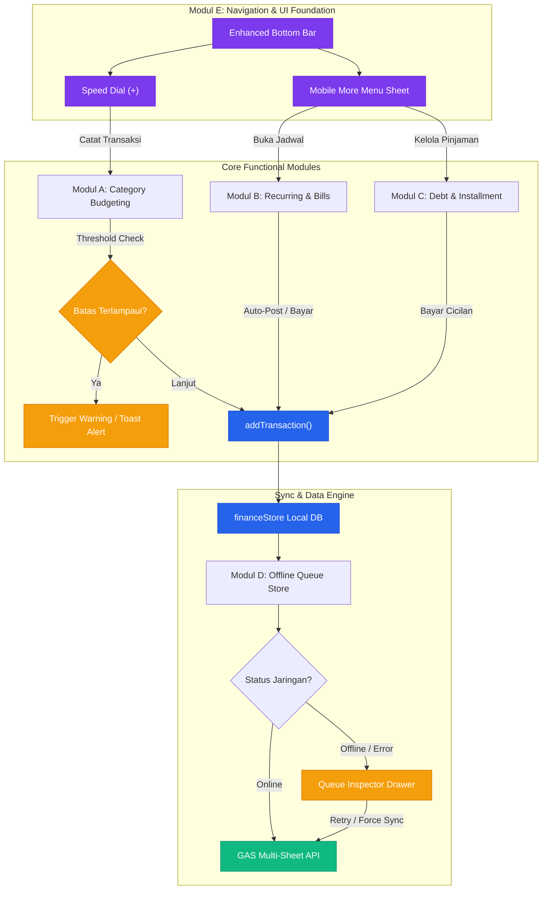
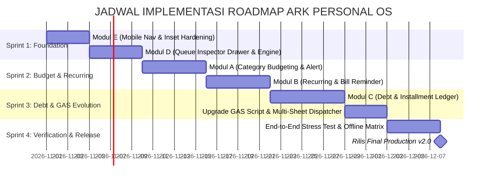

# 🗺️ ARCHITECTURAL ROADMAP & SPECIFICATION: ARK PERSONAL OS
**Dokumen Resmi Cetak Biru Pengembangan Modul Generasi Berikutnya**  
*Oleh: Lead Full-Stack Architect — ARK Personal OS*  
*Versi: 2.0.0-PROD | Status: Approved for Implementation*

---

## 📌 DAFTAR ISI
1. [Ringkasan Eksekutif & Audit Arsitektur Saat Ini](#1-ringkasan-eksekutif--audit-arsitektur-saat-ini)
2. [Modul A: Category Budgeting & Alert Thresholds](#2-modul-a-category-budgeting--alert-thresholds)
3. [Modul B: Recurring Transactions & Bill Reminder](#3-modul-b-recurring-transactions--bill-reminder)
4. [Modul C: Debt & Installment (Hutang / Piutang)](#4-modul-c-debt--installment-hutang--piutang)
5. [Modul D: Offline Queue Inspector Drawer](#5-modul-d-offline-queue-inspector-drawer)
6. [Modul E: Mobile Responsive Bottom Navigation Bar (Enhanced)](#6-modul-e-mobile-responsive-bottom-navigation-bar-enhanced)
7. [Protokol Sinkronisasi, Enkripsi & Evolusi Schema Google Apps Script](#7-protokol-sinkronisasi-enkripsi--evolusi-schema-google-apps-script)
8. [Matriks Dependensi, Diagram Alur & Timeline Rilis](#8-matriks-dependensi-diagram-alur--timeline-rilis)

---

## 1. Ringkasan Eksekutif & Audit Arsitektur Saat Ini

### 1.1 Baseline Arsitektur Aplikasi
Aplikasi **ARK Personal OS** dibangun di atas fondasi arsitektur web modern yang mengutamakan kecepatan eksekusi lokal (*local-first offline resilience*), keamanan kriptografi di sisi klien (*client-side zero-knowledge encryption*), serta ketersediaan data multi-perangkat melalui Google Apps Script (GAS) Web App dan Google Sheets sebagai *cloud database serverless*.

```
┌────────────────────────────────────────────────────────────────────────┐
│                        ARK PERSONAL OS ARCHITECTURE                    │
├────────────────────────────────────────────────────────────────────────┤
│  PRESENTATION LAYER                                                    │
│  - Svelte 4 Reactive Engine (Vite 5 Build Pipeline)                    │
│  - Tailwind & Glassmorphism Design System (app.css, Theme Tokens)      │
│  - Modals & Bottom Sheets (AddTx, Transfer, Goals, AppsScript, etc)     │
│  - Views: Beranda (Home), Analisa, Laporan (A4), Kantong, Pengguna     │
├────────────────────────────────────────────────────────────────────────┤
│  STATE & REACTIVE STORES LAYER                                         │
│  - uiStore.js      : theme, activeTab, privacyMode, toasts, modal states│
│  - authStore.js    : usersList, activeUser, sessionKey, googleAuth     │
│  - financeStore.js : transactions, pocketsList, filteredData, balances │
├────────────────────────────────────────────────────────────────────────┤
│  SECURITY & ENCRYPTION LAYER                                           │
│  - CryptoJS AES-256 CBC/PBKDF2 Storage Encryption                     │
│  - User Storage Isolation: localStorage['keuangan_db_{userId}']        │
│  - Offline Queue Isolation: localStorage['offline_queue_{userId}']     │
├────────────────────────────────────────────────────────────────────────┤
│  OFFLINE-FIRST & SYNC ENGINE                                           │
│  - Enqueue Engine: enqueueOfflineAction(action, data)                  │
│  - Sync Worker: processOfflineQueue() (Interval 15s + 'online' event)  │
│  - Cloud Remote: Google Apps Script Web App (POST JSON payload)        │
│  - Backend DB: Google Spreadsheet (Sheet Ledger 10-Kolom)              │
└────────────────────────────────────────────────────────────────────────┘
```

### 1.2 Ringkasan Hasil Audit Komponen Eksisting

| Modul / Komponen Eksisting | Lokasi Berkas | Peran Arsitektur Saat Ini | Kebutuhan Refactoring / Integrasi |
| :--- | :--- | :--- | :--- |
| **Finance Store Engine** | `src/lib/stores/financeStore.js` | Mengelola `transactions`, `pocketsList`, derived calculations `filteredData`, enqueue offline, sinkronisasi GAS. | Ditambahkan submodule store untuk Budgeting, Recurring Engine, Debt Ledger, dan Queue Observability. |
| **Auth & Multi-User Store** | `src/lib/stores/authStore.js` | Mengelola `usersList`, `activeUser`, enkripsi kunci sesi (`currentSessionKey`), isolasi database per user. | Menyediakan namespace terisolasi untuk data hutang/piutang dan anggaran per profil pengguna. |
| **UI State Controller** | `src/lib/stores/uiStore.js` | Mengelola `activeTab`, `theme`, modal flag, toast notifications. | Menampung state Drawer Inspector, Bottom Sheet navigasi mobile sekunder, dan alert threshold flags. |
| **Mobile Bottom Bar** | `src/lib/components/MobileBottomBar.svelte` | Navigasi mobile statis 4 tab + 1 FAB (`home`, `analytics`, `+`, `pockets`, `users`). | Diperluas menjadi adaptif, dynamic badge counters, touch gestures, dan speed-dial menu. |
| **Google Apps Script Bridge** | `src/lib/modals/AppsScriptModal.svelte` | Handler script `doPost(e)` untuk aksi `ping`, `sync`, `add`, `delete` pada sheet 10-kolom. | Diekspansi untuk multi-sheet / multi-action endpoint (`budgets`, `recurring`, `debts`). |
| **Analytics & Reports** | `src/lib/components/AnalyticsView.svelte` & `MonthlyReportView.svelte` | Visualisasi Chart.js, arus kas, distribusi portofolio kantong, cetak ledger PDF/A4. | Integrasi gauge bar batas anggaran per kategori dan proyeksi beban hutang bulanan. |

---

## 2. Modul A: Category Budgeting & Alert Thresholds

### 2.1 Konteks & Tujuan Bisnis
Memberikan kontrol proaktif atas pengeluaran bulanan pengguna dengan memungkinkan penetapan pagu batas anggaran (*spending ceiling*) per kategori pengeluaran (`makan`, `transport`, `belanja`, `tagihan`, `hiburan`, `kesehatan`, dll.). Dilengkapi deteksi batas dini (*early-warning thresholds*) pada tingkat 75% (Waspada), 90% (Kritis), dan ≥100% (Overbudget).

### 2.2 Milestone Implementasi Granular

```
[Milestone A.1: Data Schema & Budget Store]
                   │
                   ▼
[Milestone A.2: Real-time Threshold & Alert Engine]
                   │
                   ▼
[Milestone A.3: UI Components & Visual Gauge Bars]
                   │
                   ▼
[Milestone A.4: Sinkronisasi GAS & Enkripsi Lokal]
                   │
                   ▼
[Milestone A.5: Automated Testing & Edge Cases]
```

#### Milestone A.1: Data Schema & Budget Store Implementation
- Membuat store baru `src/lib/stores/budgetStore.js`.
- Mendefinisikan schema data `CategoryBudget`:

```typescript
interface CategoryBudget {
  id: string;               // UUID: "bgt_makan_2026_03" atau format "bgt_<catKey>_<YYYY_MM>"
  userId: string;           // Namespace pemilik anggaran (e.g., "user_rebel")
  categoryKey: string;      // Relasi ke CATEGORIES keys ('makan' | 'transport' | 'belanja' | dll)
  period: string;           // "MM/YYYY" (e.g. "03/2026") atau "monthly_default"
  limitAmount: number;      // Pagu maksimal dalam Rupiah (e.g., 2500000)
  thresholdWarningPct: number; // Default 75 (%)
  thresholdDangerPct: number;  // Default 90 (%)
  rolloverUnused: boolean;  // Apakah sisa bulan lalu ditambahkan ke bulan depan
  notes?: string;           // Catatan preferensi anggaran
  updatedAt: number;        // Timestamp epoch ms
}

interface BudgetConsumptionReport {
  categoryKey: string;
  categoryName: string;
  icon: string;
  color: string;
  limitAmount: number;
  spentAmount: number;
  remainingAmount: number;
  percentageUsed: number;
  status: 'safe' | 'warning' | 'danger' | 'overbudget';
  projectedOverspend: boolean; // Prediksi habis sebelum akhir bulan berdasarkan run-rate harian
}
```

#### Milestone A.2: Real-Time Calculation & Alert Threshold Engine
- Membangun derived store `categoryBudgetStatus` di `budgetStore.js` yang menggabungkan:
  - `$transactions` dari `financeStore.js` yang difilter berdasarkan bulan terpilih (`$selectedMonth`) dan user aktif (`$activeUser`).
  - `$budgetsList` untuk bulan tersebut.
- Logika Kalkulasi:
  $$\text{PercentageUsed} = \left(\frac{\text{SpentAmount}}{\text{LimitAmount}}\right) \times 100\%$$
- Logika Peringatan Proaktif:
  - Saat pengguna memasukkan transaksi baru di `TransactionModal.svelte`, sebelum data disimpan, sistem melakukan pre-check:
    - Jika nominal baru menyebabkan kategori menembus 75% -> Tampilkan mini alert kuning di modal form.
    - Jika menembus 90% -> Tampilkan peringatan oranye tegas dengan konfirmasi.
    - Jika menembus ≥100% -> Tampilkan peringatan merah "Overbudget" dengan rincian defisit.

#### Milestone A.3: Komponen UI & Modals
1. **`src/lib/components/CategoryBudgetCard.svelte`**:
   - Ditampilkan di Beranda (`HeroBalanceCard` section) dan Analisa.
   - Progress bar dinamis dengan CSS gradient:
     - 0% - 74%: Emerald/Green (`#10b981`)
     - 75% - 89%: Amber/Yellow (`#f59e0b`)
     - 90% - 99%: Coral/Orange (`#ea580c`)
     - ≥ 100%: Crimson/Rose (`#e11d48`) berkedip halus.
   - Angka sisa dana (*Safe-to-spend today* = $\frac{\text{Sisa Anggaran}}{\text{Sisa Hari Bulan Ini}}$).
2. **`src/lib/modals/ManageBudgetModal.svelte`**:
   - Modal sliding bottom-sheet di mobile, modal dialog di desktop.
   - Input cepat nominal pagu per kategori dengan tombol quick-step (+100rb, +500rb, +1jt).
   - Opsi copy target dari bulan sebelumnya.

#### Milestone A.4: Integrasi Database Lokal & Google Apps Script
- **Local Storage**: Tersimpan di `localStorage['app_budgets_' + userId]` terenkripsi menggunakan AES-256 dengan kunci sesi aktif `currentSessionKey`.
- **Ekstensi GAS**:
  - Penambahan sheet tab baru di Spreadsheet pengguna: `Budgets` dengan kolom:
    `[ID, User ID, Period, Category, Limit Amount, Warning Pct, Danger Pct, Updated At]`
  - Aksi `doPost(e)` di GAS:
    - `action: "sync_budgets"`: Mengambil seluruh konfigurasi anggaran pengguna.
    - `action: "save_budget"`: Menyimpan / upsert baris anggaran.
- **Portabilitas Data**: Memperbarui `exportDatabaseJSON()` dan `importDatabaseJSON()` di `financeStore.js` untuk mengikutsertakan koleksi `budgets`.

#### Milestone A.5: Strategi Pengujian (Testing Strategy)
- **Unit Tests**:
  - Validasi perhitungan persentase dengan input 0, angka normal, dan angka melampaui limit.
  - Validasi *Safe-to-Spend per day* di bulan kabisat (Februari 29 hari) dan bulan 31 hari.
- **Integration Tests**:
  - Pengujian alur input transaksi di `TransactionModal.svelte` memastikan badge status di `CategoryBudgetCard.svelte` reaktif seketika tanpa refresh halaman.
  - Simulasi offline: menetapkan budget saat koneksi mati -> antrian offline tercatat -> koneksi kembali -> sync ke GAS sukses.

---

## 3. Modul B: Recurring Transactions & Bill Reminder

### 3.1 Konteks & Tujuan Bisnis
Mengeliminasi kelalaian pencatatan tagihan rutin (listrik, wifi, sewa, asuransi, langganan aplikasi SaaS, cicilan rutin) serta pemasukan terjadwal (gaji, dividen). Menyediakan pengingat H-3 / H-1 dan tombol aksi satu kali klik (*one-click execute*) atau auto-post saat tanggal jatuh tempo tiba.

### 3.2 Milestone Implementasi Granular

```
[Milestone B.1: Recurring Data Schema & Store]
                   │
                   ▼
[Milestone B.2: Scheduler Engine & Auto-Detection Engine]
                   │
                   ▼
[Milestone B.3: Bill Reminder Dashboard Widget & Modals]
                   │
                   ▼
[Milestone B.4: Eksekusi Transaksi & Integrasi GAS]
                   │
                   ▼
[Milestone B.5: Web Push / Local Notification & UAT]
```

#### Milestone B.1: Recurring Data Schema & Store
- Berkas baru: `src/lib/stores/recurringStore.js`.
- Schema Data `RecurringRule`:

```typescript
interface RecurringRule {
  id: string;               // UUID: "rec_<timestamp>_<random>"
  userId: string;           // ID Pengguna pemilik
  title: string;            // Contoh: "Tagihan Internet Indihome"
  amount: number;           // Nominal transaksi
  type: 'expense' | 'income' | 'simpanan';
  pocket: string;           // Kantong sumber/tujuan (e.g. 'cash', 'tabungan')
  category: string;         // Kategori (e.g. 'tagihan', 'gaji')
  frequency: 'daily' | 'weekly' | 'monthly' | 'yearly';
  interval: number;         // Default 1 (setiap 1 bulan, setiap 2 minggu, dll)
  dueDay: number;           // Tanggal jatuh tempo (1 - 31)
  startDate: string;        // "DD/MM/YYYY"
  endDate?: string | null;  // Nullable jika langganan terus berjalan
  autoPost: boolean;        // true = sistem langsung catat otomatis; false = perlu konfirmasi manual
  reminderDaysBefore: number[]; // e.g. [3, 1, 0] (H-3, H-1, Hari H)
  status: 'active' | 'paused' | 'archived';
  lastProcessedPeriod?: string; // "MM/YYYY" transaksi terakhir dieksekusi agar tidak double-charge
  createdAt: number;
}
```

#### Milestone B.2: Background Scheduler & Idempotent Execution Engine
- Mekanisme **Idempotency**: Menjamin transaksi berulang tidak pernah tercatat ganda pada periode yang sama:
  - Sebelum aturan dieksekusi, sistem memeriksa apakah ada transaksi riil di `transactions` pada periode berjalan dengan tag `recurringRuleId === rule.id` dan tanggal yang sesuai.
- Lifecycle Hook:
  - Dipicu saat:
    1. Aplikasi dibuka (`onMount` di `App.svelte`).
    2. Pergantian tanggal (interval timer 1 jam).
    3. Event `app-logged-in`.
- Logika Evaluasi:
  - Menghitung $H - \text{Hari Jatuh Tempo}$.
  - Mengelompokkan status menjadi:
    - 🔴 `Overdue`: Sudah lewat tanggal tempo namun belum tercatat.
    - 🟡 `Due Soon`: Berada dalam rentang `reminderDaysBefore` (misal H-3 sampai H-1).
    - 🟢 `Upcoming`: Masih lebih dari rentang pengingat.
    - ⚪ `Paid / Processed`: Sudah dieksekusi untuk bulan ini.

#### Milestone B.3: Komponen UI & Modals
1. **`src/lib/components/BillReminderWidget.svelte`**:
   - Disematkan di Beranda di atas riwayat transaksi.
   - Menampilkan carousel kartu tagihan yang jatuh tempo dalam 7 hari ke depan.
   - Tombol instan: **"Bayar Sekarang"** (langsung membuka konfirmasi bayar dan potong saldo kantong terkait).
2. **`src/lib/modals/ManageRecurringModal.svelte`**:
   - Daftar seluruh tagihan/rutinitas berkala.
   - Toggle aktif/jeda (`active` / `paused`).
   - Filter tab: "Semua", "Tagihan Pengeluaran", "Pemasukan Rutin".
3. **`src/lib/modals/AddRecurringModal.svelte`**:
   - Form pembuatan aturan berulang dengan selector interval, tanggal jatuh tempo, dan opsi toggle "Catat Otomatis".

#### Milestone B.4: Eksekusi Transaksi & Sinkronisasi GAS
- Saat tagihan dibayar (manual atau auto-post):
  - Memanggil `addTransaction()` di `financeStore.js` dengan metadata khusus:
    `{ recurringRuleId: rule.id, desc: `${rule.title} (Rutin)`, ... }`.
  - Transaksi otomatis masuk ke antrian offline (`enqueueOfflineAction`) dan disinkronkan ke Spreadsheet.
- Update status aturan di `recurringStore.js` (`lastProcessedPeriod = currentPeriod`).
- Tabel GAS: Sheet `RecurringRules` untuk sinkronisasi konfigurasi tagihan.

#### Milestone B.5: Strategi Pengujian (Testing Strategy)
- **Date Edge Cases**:
  - Uji tagihan tanggal 31 pada bulan Februari (28/29 hari) dan April (30 hari). Sistem harus otomatis menyesuaikan ke hari terakhir bulan tersebut (*EOM clamping*).
- **Double Execution Prevention Test**:
  - Simulasi membuka aplikasi 10 kali dalam satu hari dengan `autoPost: true`. Pastikan transaksi hanya dibuat tepat 1 kali.
- **Offline Post Test**:
  - Tagihan dieksekusi saat offline -> transaksi kas lokal terbentuk -> saldo kantong berkurang seketika -> sinkron saat online.

---

## 4. Modul C: Debt & Installment (Hutang / Piutang)

### 4.1 Konteks & Tujuan Bisnis
Mengelola catatan pinjam-meminjam uang secara terstruktur, membedakan secara tegas antara:
1. **Hutang Saya (Payable / Owed to Others)**: Kewajiban yang harus dibayar pengguna.
2. **Piutang Saya (Receivable / Lent to Others)**: Dana pengguna yang dipinjam oleh rekan/klien.
Dilengkapi pelacakan riwayat cicilan bertahap (*installment milestones*), kalkulasi sisa pokok, tanggal jatuh tempo, dan integrasi dua arah (*bidirectional*) dengan saldo kas kantong.

### 4.2 Milestone Implementasi Granular

```
[Milestone C.1: Debt & Payment Ledger Schema]
                   │
                   ▼
[Milestone C.2: Debt Store & Bi-directional Pocket Sync]
                   │
                   ▼
[Milestone C.3: UI View, Debt Cards & Installment Modal]
                   │
                   ▼
[Milestone C.4: GAS Multi-Table Integration & Encryption]
                   │
                   ▼
[Milestone C.5: Financial Balance Sheet Reconciliation Tests]
```

#### Milestone C.1: Data Schema Hutang & Piutang
- Berkas baru: `src/lib/stores/debtStore.js`.
- Schema Data `DebtRecord` & `DebtPayment`:

```typescript
interface DebtRecord {
  id: string;               // UUID: "debt_<timestamp>_<rand>"
  userId: string;           // Pemilik profil
  type: 'debt' | 'receivable'; // 'debt' = Hutang Saya, 'receivable' = Piutang Saya
  counterpartyName: string; // Nama pihak kedua (e.g., "Budi Santoso", "Bank BCA")
  contactInfo?: string;     // No HP / Catatan kontak
  totalAmount: number;      // Total nominal pinjaman awal
  remainingAmount: number;  // Sisa nominal yang belum terbayar
  initialPocketId: string;  // Kantong yang menerima dana (hutang) atau mengeluarkan dana (piutang)
  dueDate: string;          // Format "DD/MM/YYYY"
  startDate: string;        // Format "DD/MM/YYYY"
  status: 'active' | 'partially_paid' | 'settled' | 'defaulted';
  notes?: string;           // Keterangan tujuan pinjaman
  createdAt: number;
}

interface DebtPayment {
  id: string;               // UUID: "pmt_<timestamp>"
  debtId: string;           // Referensi ke DebtRecord.id
  userId: string;
  paymentDate: string;      // "DD/MM/YYYY"
  amountPaid: number;       // Nominal cicilan yang dibayarkan
  pocketId: string;         // Kantong yang digunakan untuk membayar/menerima cicilan
  linkedTransactionId: string; // Relasi ke ID transaksi di financeStore
  notes?: string;
  createdAt: number;
}
```

#### Milestone C.2: Bi-Directional Pocket Sync & Balance Calculations
- **Pencatatan Pinjaman Baru**:
  - Opsi: *Mempengaruhi Saldo Kas Saat Ini?* (Default: Ya).
  - Jika `type === 'debt'` (Hutang Saya): Menghasilkan transaksi `income` ke `initialPocketId` (Kas bertambah karena pinjaman cair).
  - Jika `type === 'receivable'` (Piutang Saya): Menghasilkan transaksi `expense` dari `initialPocketId` (Kas berkurang karena meminjamkan uang ke orang lain).
- **Pembayaran Cicilan (`recordPayment`)**:
  - Jika membayar Hutang Saya: Mengurangi `remainingAmount`, menghasilkan transaksi `expense` dari kantong yang dipilih dengan kategori `tagihan` atau `hutang`.
  - Jika menerima cicilan Piutang: Mengurangi `remainingAmount`, menghasilkan transaksi `income` ke kantong yang dipilih.
  - Saat `remainingAmount <= 0`, status pinjaman otomatis berubah menjadi `'settled'` (Lunas) disertai selebrasi confetti.

#### Milestone C.3: Komponen UI & Modals
1. **`src/lib/components/DebtManagerView.svelte`**:
   - Dapat diakses sebagai tab baru di Navigasi Desktop / Mobile More Menu.
   - Ringkasan Metrik Finansial:
     - 💳 **Total Hutang Saya** (Kewajiban)
     - 🤝 **Total Piutang Saya** (Aset Tertahan)
     - ⚖️ **Posisi Bersih Hutang (*Net Debt Exposure*)** = $\text{Total Piutang} - \text{Total Hutang}$
2. **`src/lib/components/DebtCard.svelte`**:
   - Kartu visual tiap debitur/kreditur dengan progress bar pelunasan cicilan, badge status (`Aktif`, `Sebagian`, `Lunas`), dan tag hari menuju jatuh tempo.
3. **`src/lib/modals/AddDebtModal.svelte`**:
   - Dialog pembuatan catatan hutang/piutang baru dengan validasi tanggal dan pemilih kantong.
4. **`src/lib/modals/PayInstallmentModal.svelte`**:
   - Form bayar cicilan dengan slider nominal, opsi "Lunasi Seluruhnya", dan pemilih kantong sumber dana.

#### Milestone C.4: Integrasi Database Lokal & Google Apps Script
- **Local Storage**: `localStorage['app_debts_' + userId]` dan `localStorage['app_debt_payments_' + userId]` (AES-256).
- **Ekstensi GAS**:
  - Penambahan sheet tab: `Debts` dan `DebtPayments`.
  - Action di GAS: `sync_debts`, `save_debt`, `delete_debt`, `record_debt_payment`.
- **Integrasi Backup**: Terangkum penuh dalam JSON Export/Import.

#### Milestone C.5: Strategi Pengujian (Testing Strategy)
- **Reconciliation Integrity Test**:
  - Memverifikasi bahwa jumlah seluruh `DebtPayment.amountPaid` ditambah `DebtRecord.remainingAmount` selalu sama persis dengan `DebtRecord.totalAmount`.
- **Cascade Deletion Test**:
  - Menghapus transaksi yang terhubung dengan pembayaran cicilan harus memicu peringatan sinkronisasi status sisa hutang.
- **Rollback Test**:
  - Jika pembayaran cicilan gagal disimpan/batal, transaksi kas tidak boleh terpotong.

---

## 5. Modul D: Offline Queue Inspector Drawer

### 5.1 Konteks & Tujuan Bisnis
Mengubah antrian offline yang sebelumnya tidak terlihat (*opaque blackbox*) menjadi transparan dan dapat dipantau sepenuhnya oleh pengguna. Pengguna dapat melihat payload transaksi yang tertahan, alasan kegagalan koneksi (*network timeout, Google Apps Script error 429/500*), serta memiliki kontrol penuh untuk melakukan *Force Sync All*, *Retry Item*, *Edit Payload*, atau *Discard*.

### 5.2 Milestone Implementasi Granular

```
[Milestone D.1: Enhanced Queue Item Model & Reactive Queue Store]
                               │
                               ▼
[Milestone D.2: Resilient Sync Engine with Exponential Backoff]
                               │
                               ▼
[Milestone D.3: Sliding Drawer UI & Component Breakdown]
                               │
                               ▼
[Milestone D.4: Quick Action Controllers & Conflict Resolution]
                               │
                               ▼
[Milestone D.5: Network Simulation & Fault-Tolerance Tests]
```

#### Milestone D.1: Enhanced Queue Item Model & Reactive Queue Store
- Mengupgrade struktur item antrian di `financeStore.js` menjadi format observabilitas tinggi:

```typescript
interface QueueItem {
  id: string;               // Unique: "sync_<timestamp>_<random>"
  action: 'add' | 'edit' | 'delete' | 'transfer' | 'budget_save' | 'debt_save';
  userId: string;           // Namespace pemilik antrian
  payload: any;             // Data transaksi / entitas terkait
  timestamp: number;        // Waktu pertama kali antri (epoch ms)
  retryCount: number;       // Jumlah percobaan yang gagal
  maxRetries: number;       // Default 5 kali
  status: 'pending' | 'syncing' | 'failed' | 'conflict';
  lastAttempt?: number;     // Waktu percobaan terakhir
  lastErrorMessage?: string;// Pesan error HTTP / GAS terakhir (e.g. "Fetch timeout after 20s")
  priority: number;         // 1 = High (Transactions), 2 = Normal (Budgets/Rules)
}
```
- Membuat store reaktif `offlineQueueStore` di `src/lib/stores/queueStore.js` agar komponen UI otomatis bereaksi (*re-render*) secara real-time saat queue bertambah, berubah status, atau terhapus.

#### Milestone D.2: Resilient Sync Engine with Exponential Backoff
- Mengganti loop serial polos pada `processOfflineQueue()` dengan algoritma ketahanan:
  - Jeda antar retry (*Exponential Backoff with Jitter*):
    $$\text{Delay} = \min\left(1000 \times 2^{\text{retryCount}} + \text{jitter}, 30000\right)\text{ ms}$$
  - Jika item gagal lebih dari `maxRetries` (5 kali) -> Status diubah menjadi `'failed'` (Dead Letter Queue) agar antrian lain di belakangnya tidak macet (*no head-of-line blocking*).
  - Indikator sync di navbar menampilkan status: `Ada 1 Gagal - Klik untuk Periksa`.

#### Milestone D.3: Sliding Drawer UI & Komponen
1. **`src/lib/components/OfflineQueueDrawer.svelte`**:
   - Komponen Drawer modern: slide-in dari sisi kanan pada layar desktop/tablet, slide-up bottom sheet pada layar smartphone.
   - Glassmorphism backdrop dengan blur halus (`backdrop-blur-md`).
   - Header: Status koneksi saat ini (🟢 Online / 🔴 Offline), Jumlah antrian aktif, Jumlah item gagal.
   - Tombol Toolbar:
     - 🚀 **"Unggah Semua Sekarang"** (Force Immediate Sync)
     - 🧹 **"Hapus Item Gagal"**
     - 📋 **"Salin Debug Log JSON"**
2. **`src/lib/components/QueueItemCard.svelte`**:
   - Menampilkan detail tiap item:
     - Badge Aksi (`TAMBAH`, `UBAH`, `HAPUS`, `TRANSFER`).
     - Deskripsi ringkas transaksi dan nominal.
     - Timestamp relatif (e.g., "5 menit yang lalu").
     - Badge status warna (`pending` = kuning, `syncing` = biru berputar, `failed` = merah).
     - Error callout expandable jika terjadi kegagalan transmisi.
     - Action buttons per item: 🔄 *Coba Lagi*, ✏️ *Edit Data*, 🗑️ *Batalkan*.

#### Milestone D.4: Quick Trigger & Conflict Resolution Protocol
- **Trigger Universal**:
  - Klik pada indikator sync pill di `Navbar.svelte` (`sync-status-pill`) dan badge di `MobileBottomBar.svelte` langsung membuka drawer ini jika antrian $> 0$.
- **Resolusi Konflik Data**:
  - Jika Spreadsheet melaporkan versi id transaksi telah berubah:
    - Opsi *Last-Write-Wins (LWW)* default.
    - Dialog komparasi visual side-by-side (Versi Lokal vs Versi Cloud) untuk konfirmasi pengguna.

#### Milestone D.5: Strategi Pengujian (Testing Strategy)
- **Simulasi Jaringan Ekstrem**:
  - Uji transmisi dengan latency 10.000 ms, error HTTP 503 Service Unavailable, dan pemutusan koneksi mendadak di tengah antrian ke-3 dari 10 item.
- **Queue Mutation Test**:
  - Menguji edit transaksi yang masih berada di dalam antrian offline (harus memperbarui payload antrian secara in-place tanpa membuat duplikat).

---

## 6. Modul E: Mobile Responsive Bottom Navigation Bar (Enhanced)

### 6.1 Konteks & Tujuan Bisnis
Mengoptimalkan pengalaman pengguna di perangkat smartphone agar setara dengan standar aplikasi perbankan modern (Blu, Jago, Jenius). Menghadirkan navigasi yang tahan terhadap *safe-area-inset* sistem operasi (iPhone home indicator, Android gesture bars), dynamic badge notification counters, serta arsitektur menu sekunder (*More Menu Bottom Sheet*) untuk menampung ekspansi modul baru tanpa membuat tampilan sempit.

### 6.2 Milestone Implementasi Granular

```
[Milestone E.1: Navigation Hierarchy & Badge Store Registry]
                                │
                                ▼
[Milestone E.2: UI/UX Refactoring & Safe-Area Inset Hardening]
                                │
                                ▼
[Milestone E.3: Floating Speed-Dial Action Button (+)]
                                │
                                ▼
[Milestone E.4: Mobile Secondary Menu Bottom Sheet]
                                │
                                ▼
[Milestone E.5: Gesture Navigation & Multi-Device Testing]
```

#### Milestone E.1: Navigation Hierarchy & Badge Store Registry
- Arsitektur Tab Navigasi Primer (5 Slot Utama Mobile):
  1. 🏠 **Beranda** (`home`): Dashboard ringkasan, hero balance, kartu saldo, riwayat transaksi.
  2. 👛 **Kantong** (`pockets`): Manajemen alokasi pos dana & target impian.
  3. ＋ **Aksi Cepat** (*Floating Center FAB*): Speed-dial multi-pilihan pencatatan.
  4. 📊 **Analisa** (`analytics`): Grafik pengeluaran, perbandingan bulanan, budget category.
  5. ☰ **Lainnya** (`more`): Membuka *MobileMoreMenuSheet* untuk akses modul Laporan A4, Hutang/Piutang, Pengguna & Database, serta Offline Inspector Drawer.
- Derived Store `navBadgeStore` di `uiStore.js`:
  - Menghitung total notifikasi aktif:
    $$\text{TotalBadge} = \text{offlineQueueCount} + \text{overdueBillsCount} + \text{overbudgetCount}$$
  - Menampilkan titik merah (*notification dot*) atau angka counter pada tab terkait.

#### Milestone E.2: UI/UX Refactoring & Safe-Area Inset Hardening
- Perbaikan layout CSS di `src/styles/app.css` & `MobileBottomBar.svelte`:
  - `padding-bottom: max(12px, env(safe-area-inset-bottom));`
  - Isolasi *z-index* tinggi (`z-index: 990`) dengan `backdrop-filter: blur(20px) saturate(180%);`
  - Kontras tinggi yang lulus uji WCAG 2.1 AA di kedua mode (Dark `#0b0f19` dan Light `#ffffff`).
  - Active tab spring indicator: Indikator visual berupa pill bulat lembut beranimasi di belakang icon aktif.

#### Milestone E.3: Floating Speed-Dial Action Button (+)
- FAB tengah di-upgrade dari satu aksi menjadi **Speed-Dial Popover**:
  - Saat tombol `+` ditekan, muncul menu radial / floating stack elegan:
    - 🔴 **Catat Pengeluaran** (membuka `TransactionModal` mode expense).
    - 🟢 **Catat Pemasukan** (membuka `TransactionModal` mode income).
    - ⇄ **Pindah Saldo Kantong** (membuka `PocketTransferModal`).
    - 🤝 **Catat Hutang / Piutang** (membuka `AddDebtModal`).
  - Micro-haptic feedback visual (animasi rotasi tombol `+` 45 derajat menjadi tanda silang `✕`).

#### Milestone E.4: Mobile Secondary Menu Bottom Sheet (`MobileMoreMenuSheet.svelte`)
- Menampilkan grid icon modern untuk fitur-fitur sekunder:
  - 📑 **Laporan Bulanan (A4 Print Ready)**
  - 🤝 **Hutang & Cicilan (Debt Manager)**
  - 🎯 **Target Finansial & Harga Emas**
  - 👥 **Kelola Pengguna & Google Sync**
  - 📡 **Offline Queue Inspector** (lengkap dengan badge jumlah item)
  - 🌓 **Ganti Tema Gelap / Terang**
  - 👁️ **Mode Privasi Saldo**

#### Milestone E.5: Strategi Pengujian (Testing Strategy)
- **Device Viewport Matrix**:
  - Pengujian pada berbagai resolusi mobile: iPhone SE (375px), iPhone 14/15 Pro (393px), iPhone 15 Pro Max (430px), Samsung Galaxy S23 (360px), dan tablet iPad mini (768px).
- **Safe Area Inset Test**:
  - Memastikan tombol navigasi tidak pernah tertutup oleh bar navigasi virtual Android maupun Home Indicator bar iOS.
- **Accessibility & Focus Test**:
  - Navigasi keyboard (Tab + Enter) dan screen reader tags (`aria-label`, `aria-current="page"`, `role="tab"`).

---

## 7. Protokol Sinkronisasi, Enkripsi & Evolusi Schema Google Apps Script

### 7.1 Standar Enkripsi Lokal (Zero-Knowledge Client Storage)
Setiap data dari modul baru (Budgets, Recurring Rules, Debts, Queue) wajib mematuhi standar enkripsi yang telah diterapkan pada `financeStore.js`:
- Algoritma: **AES-256 (CBC mode dengan PBKDF2 key derivation)** via `crypto-js`.
- Kunci Enkripsi: Diambil dinamis dari `currentSessionKey` milik pengguna aktif.
- Storage Namespace Keys:
  - Transaksi: `keuangan_db_{userId}`
  - Anggaran: `app_budgets_{userId}`
  - Tagihan Rutin: `app_recurring_{userId}`
  - Hutang & Cicilan: `app_debts_{userId}` & `app_debt_pmt_{userId}`
  - Antrian Sinkronisasi: `offline_queue_{userId}`

### 7.2 Evolusi Schema Google Apps Script (GAS) Web App
Agar tidak merusak (*breaking changes*) kompatibilitas spreadsheet pengguna lama yang masih menggunakan sheet 10-kolom tunggal, arsitektur Google Apps Script dievolusikan menggunakan **Multi-Sheet Modular Dispatcher**:

```javascript
// Cuplikan Desain Ekstensi Apps Script v2.0
function doPost(e) {
  var lock = LockService.getScriptLock();
  lock.tryLock(25000); // Mencegah race-condition write concurrency
  
  try {
    var data = JSON.parse(e.postData.contents);
    var action = data.action;
    var ss = SpreadsheetApp.getActiveSpreadsheet();
    
    // ROUTER AKSI
    switch(action) {
      // 1. MODUL TRANSAKSI UTAMA (Eksisting)
      case "sync":
      case "add":
      case "delete":
        return handleTransactionSheet(ss, action, data);
        
      // 2. MODUL A: BUDGETING
      case "sync_budgets":
      case "save_budget":
      case "delete_budget":
        return handleBudgetSheet(ss, action, data);
        
      // 3. MODUL B: RECURRING
      case "sync_recurring":
      case "save_recurring":
      case "delete_recurring":
        return handleRecurringSheet(ss, action, data);
        
      // 4. MODUL C: DEBT & INSTALLMENT
      case "sync_debts":
      case "save_debt":
      case "record_debt_payment":
        return handleDebtSheet(ss, action, data);
        
      default:
        return createJsonResponse({ status: "error", message: "Aksi tidak dikenali: " + action });
    }
  } catch(err) {
    return createJsonResponse({ status: "error", message: err.toString() });
  } finally {
    lock.releaseLock();
  }
}
```

### 7.3 Pemetaan Tabel Google Sheets Baru

| Nama Sheet Tab | Header Kolom | Fungsi Data |
| :--- | :--- | :--- |
| **`Transactions`** *(Eksisting)* | `ID, Tanggal, Keterangan, Nominal, Tipe, Sumber, Kantong, Kategori, User ID, User Name` | Buku besar kas masuk & keluar. |
| **`Budgets`** *(Baru)* | `ID, User ID, Period, Category, Limit Amount, Warning Pct, Danger Pct, Updated At` | Konfigurasi pagu batas anggaran per kategori. |
| **`Recurring`** *(Baru)* | `ID, User ID, Title, Amount, Type, Pocket, Category, Frequency, Interval, Due Day, Auto Post, Status, Last Period` | Aturan transaksi dan tagihan terjadwal. |
| **`Debts`** *(Baru)* | `ID, User ID, Type, Counterparty, Total Amount, Remaining Amount, Pocket ID, Due Date, Status, Notes, Created At` | Daftar buku hutang dan piutang. |
| **`DebtPayments`** *(Baru)* | `ID, Debt ID, User ID, Payment Date, Amount Paid, Pocket ID, Linked Tx ID, Notes` | Riwayat pembayaran cicilan per pinjaman. |

---

## 8. Matriks Dependensi, Diagram Alur & Timeline Rilis

### 8.1 Visual Flowchart: Alur Eksekusi & Keterkaitan Antar Modul



### 8.2 Matriks Dependensi Modul

| Modul | Membutuhkan (*Dependencies*) | Dibutuhkan Oleh (*Dependents*) | Tingkat Risiko Teknis |
| :--- | :--- | :--- | :--- |
| **Modul E: Mobile Nav & More Menu** | `uiStore.js`, `app.css` | Seluruh modul baru untuk entry-point UI mobile | **Rendah** (Visual & Navigation Refactoring) |
| **Modul D: Queue Inspector Drawer** | `financeStore.js` (offline queue), `uiStore.js` | Modul A, B, C (sebagai monitoring sinkronisasi) | **Sedang** (Sync engine refactoring) |
| **Modul A: Category Budgeting** | `financeStore.js`, `Modul E` | `AnalyticsView.svelte`, `HeroBalanceCard.svelte` | **Sedang** (Real-time reactivity engine) |
| **Modul B: Recurring & Bills** | `financeStore.js`, `Modul E`, `authStore.js` | `HeroBalanceCard.svelte` (widget reminder) | **Sedang** (Idempotency & Scheduler engine) |
| **Modul C: Debt & Installment** | `financeStore.js`, `Modul E`, `Modul D` | Financial Balance Sheet & Cashflow analytics | **Tinggi** (Bi-directional balance transaction link) |

---

### 8.3 Rencana Sprint & Timeline Pelaksanaan Granular



#### Rincian Deliverable per Sprint:
- **Sprint 1 (Fondasi Navigasi & Ketahanan Offline)**:
  - ✅ Implementasi `MobileMoreMenuSheet.svelte` dan `MobileBottomBar.svelte` refactor.
  - ✅ Implementasi `queueStore.js` dan `OfflineQueueDrawer.svelte`.
  - *Keluaran*: Pengguna memiliki navigasi mobile yang rapi dan antrian offline yang dapat dipantau/di-retry langsung.
- **Sprint 2 (Kontrol Pengeluaran & Otomasi Tagihan)**:
  - ✅ Implementasi `budgetStore.js`, `CategoryBudgetCard.svelte`, dan validasi threshold di `TransactionModal`.
  - ✅ Implementasi `recurringStore.js`, `BillReminderWidget.svelte`, dan auto-post scheduler.
  - *Keluaran*: Peringatan dini pengeluaran per kategori aktif dan reminder tagihan rutin siap pakai.
- **Sprint 3 (Buku Hutang/Piutang & Evolusi Cloud)**:
  - ✅ Implementasi `debtStore.js`, `DebtManagerView.svelte`, `DebtCard.svelte`, `PayInstallmentModal.svelte`.
  - ✅ Pembaharuan kode Google Apps Script di `AppsScriptModal.svelte` untuk multi-sheet support.
  - *Keluaran*: Pengguna dapat mengelola hutang/piutang dengan cicilan otomatis memotong kas kantong.
- **Sprint 4 (Hardening, Validasi & Rilis)**:
  - ✅ Uji regresi offline 100% tanpa internet.
  - ✅ Validasi backup database JSON (export dan import seluruh modul baru).
  - ✅ Rilis resmi ARK Personal OS v2.0.

---

*Dokumen roadmap ini disusun oleh Lead Full-Stack Architect untuk menjadi panduan kerja terpadu bagi tim pengembang frontend, store engineer, dan database integrator.*
